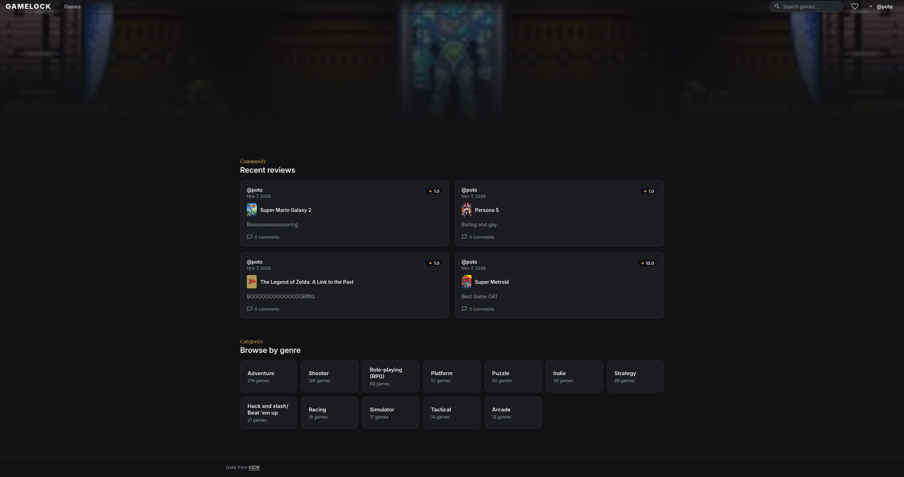
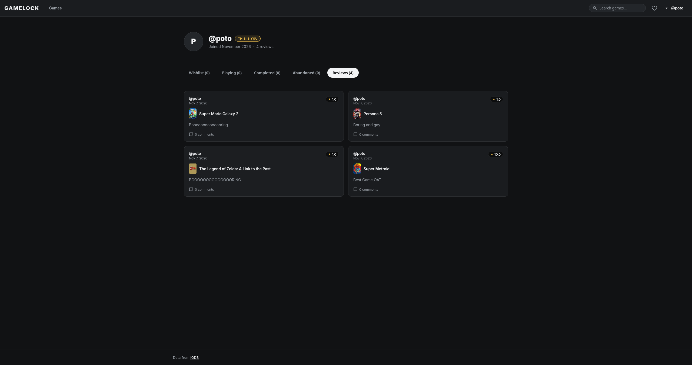

# Gamelock - Sitio web de seguimiento de videojuegos

Aplicación web donde los usuarios llevan un registro de los juegos que juegan. Cada usuario puede marcar un juego como en lista de deseos, jugando, completado o abandonado, escribir una reseña con una puntuación del 1 al 10 y comentar en las reseñas de otros usuarios. La página de inicio muestra listas como los juegos mejor valorados, los más deseados y los más abandonados.

Equipo: Rodrigo Cortes - Enzo Dias - Ulices Ramires - Dan Gomez

## Características

- Registro, inicio y cierre de sesión (Autenticación JWT, contraseñas almacenadas con hash).
- Página de inicio con un carrusel principal y listas: mejor valorados, más deseados, más jugados ahora mismo, más completados, más abandonados y reseñas recientes.
- Explorar y buscar juegos, filtrar por género y ordenar por valoración, título, fecha de lanzamiento o número de reseñas.
- Página del juego con descripción, géneros, plataformas, puntuación promedio y cuántos usuarios lo tienen en cada estado.
- Biblioteca: añade un juego a tu lista de deseos, márcalo como jugando, completado o abandonado.
- Reseñas: una reseña por usuario y juego, con una puntuación del 1 al 10 y un texto opcional. Se pueden editar y eliminar.
- Comentarios en las reseñas. El autor del comentario o el autor de la reseña pueden eliminar un comentario.
- Perfil de usuario con la biblioteca dividida por estado y la lista de reseñas.
- Funciona en escritorio y móvil.

## Tecnologías

Backend
- Python
- FastAPI (REST API, JSON)
- SQLAlchemy 2 (ORM) and Alembic (migraciones de base de datos)
- psycopg 3 (PostgreSQL driver)
- Pydantic and pydantic-settings (validación y configuración)
- PyJWT (tokens) and pwdlib with argon2 (hash de contraseñas)
- httpx (peticiones a IGDB)
- Uvicorn (server) and pytest (pruebas)

Frontend
- Angular (standalone components, Router, Signals, httpResource, Reactive Forms)
- Angular Material y Angular CDK
- TypeScript, HTML y SCSS (CSS)
- RxJS
- Vitest (pruebas unitarias)
- Fuentes: Inter y Playfair Display (Google Fonts)

Database
- PostgreSQL 16, ejecutado con Docker Compose

External data
- Se utiliza la API de IGDB (https://api-docs.igdb.com) como base de datos de juegos. Los juegos se importan desde IGDB a nuestra propia base de datos PostgreSQL, por lo que el sitio los lee desde allí. Los datos de los juegos y las imágenes provienen de IGDB.

## Estructura del proyecto

```
backend/
  app/            Aplicación FastAPI (routers, models, schemas, services)
  alembic/        Migraciones de la base de datos
  scripts/        seed_games.py y seed_demo.py
  tests/          pruebas de pytest
frontend/
  src/app/        Aplicación Angular (pages, components, services, guards, interceptors)
docker-compose.yml
.env.example
```

## Requisitos

- Docker Desktop (para la base de datos)
- Python 3.12 or superior (we used 3.14)
- Node.js 22 or superior and npm (usamos Node 24)
- Credenciales de desarrollador de Twitch (Client ID and Client Secret) para IGDB (https://api-docs.igdb.com)

## Cómo ejecutarlo

Los comandos son para PowerShell en Windows. En macOS o Linux, activa el entorno virtual con `source .venv/bin/activate` en su lugar.

Necesitas tres cosas ejecutándose al mismo tiempo: la base de datos, el backend y el frontend. Usa una terminal para cada uno.

### 1. Clonar el repositorio

```
git clone https://github.com/Yuukii-i/Taller2WebMovil.git
cd Taller2WebMovil
```

### 2. Crear el archivo .env

Copia el archivo de ejemplo en la carpeta raíz del proyecto:

```
copy .env.example .env
```

Luego abre `.env` y establece los valores:

- `POSTGRES_PASSWORD`: cualquier contraseña que desees para la base de datos. Usa la misma contraseña dentro de `DATABASE_URL`.
- `JWT_SECRET`: un texto largo y aleatorio, de al menos 32 caracteres. Puedes generar uno con:
  ```
  python -c "import secrets; print(secrets.token_urlsafe(48))"
  ```
- `IGDB_CLIENT_ID` e `IGDB_CLIENT_SECRET`: tus credenciales de desarrollador de Twitch para IGDB (https://dev.twitch.tv/console/apps).
- Los demás valores pueden quedarse como están.

El archivo `.env` es ignorado por git, nunca lo subas.

### 3. Iniciar la base de datos

Abre Docker Desktop y espera hasta que se esté ejecutando, luego:

```
docker compose up -d db
```

Comprueba que el contenedor `web_movil_db` esté activo con `docker ps`.

### 4. Configurar e iniciar el backend  

En una nueva terminal:

```
cd backend
python -m venv .venv
.venv\Scripts\Activate.ps1
pip install -r requirements.txt
alembic upgrade head
uvicorn app.main:app --reload
```

La API se ejecuta en http://localhost:8000 y la documentación interactiva está en http://localhost:8000/docs.

Si PowerShell no te permite activar el entorno, ejecuta esto una vez e inténtalo de nuevo:

```
Set-ExecutionPolicy -Scope CurrentUser -ExecutionPolicy RemoteSigned
```

### 5. Importar los juegos

En otra terminal, con el entorno virtual activo (el prompt comienza con `(.venv)`):

```
cd backend
.venv\Scripts\Activate.ps1
python -m scripts.seed_games
```

Esto descarga alrededor de 300 juegos populares de IGDB y los guarda en la base de datos. Tarda aproximadamente un minuto y se puede volver a ejecutar sin crear duplicados. Necesita `IGDB_CLIENT_ID` e `IGDB_CLIENT_SECRET` del paso 2.

### 6. Opcional: datos de demostración (demo)

Para ver el sitio con usuarios, reseñas y comentarios, crea los datos de demostración. La contraseña para las cuentas de demostración se lee de `DEMO_USER_PASSWORD` en tu archivo `.env` (o también se puede establecer a través de una variable de entorno):

```
python -m scripts.seed_demo
```

Esto crea 15 usuarios de demostración con entradas de biblioteca, reseñas y comentarios. Puedes iniciar sesión con cualquiera de ellos, por ejemplo, el nombre de usuario `pixelpilot` y la contraseña que elegiste. Para eliminar y crear los datos de demostración nuevamente usa `python -m scripts.seed_demo --reset`. Solo los usuarios de demostración (correos que terminan en `@demo.local`) se ven afectados.

### 7. Iniciar el frontend

En una tercera terminal:

```
cd frontend
npm install
npm start
```

Abre http://localhost:4200 en el navegador. La primera vez puede tardar un poco en compilar. La terminal se mantiene ocupada mientras el servidor se está ejecutando, eso es normal.

### Detener todo

Presiona Ctrl+C en las terminales del backend y frontend. Para detener la base de datos ejecuta `docker compose stop`. Los datos se mantienen en un volumen de Docker, por lo que seguirán ahí la próxima vez.

## Pruebas

Backend (el contenedor de la base de datos debe estar ejecutándose, las pruebas usan una base de datos separada llamada`<POSTGRES_DB>_test` que se crea automáticamente):

```
cd backend
.venv\Scripts\Activate.ps1
pytest -q
```

Frontend:

```
cd frontend
npm test
```

## Resumen de la API

Todas las rutas comienzan con `/api`. Las rutas marcadas con (login) necesitan el encabezado `Authorization: Bearer <token>` La lista completa está en la página de Swagger en `/docs`.

- Autenticación: `POST /auth/register`, `POST /auth/login`, `POST /auth/logout` (login), `GET /users/me` (login)
- Juegos: `GET /games`, `GET /games/{id}`, `GET /genres`
- Biblioteca: `PUT /library/{game_id}` (login), `DELETE /library/{game_id}` (login), `GET /users/{username}/library`
- Reseñas: `GET /games/{id}/reviews`, `POST /games/{id}/reviews` (login), `GET /reviews/{id}`, `PUT /reviews/{id}` (login), `DELETE /reviews/{id}` (login), `GET /users/{username}/reviews`
- Comentarios: `GET /reviews/{id}/comments`, `POST /reviews/{id}/comments` (login), `DELETE /comments/{id}` (login)
- Inicio: `GET /home`

## Notas

- El token se guarda en el localStorage del navegador. Está bien para un proyecto universitario, pero un sitio en producción debería usar algo más seguro.
- Si IGDB no está disponible, el sitio sigue funcionando con los juegos ya guardados en la base de datos. Solo la búsqueda de juegos que nunca fueron importados necesita IGDB.
- No hagas commit del archivo `.env` Solo `.env.example` está en el repositorio, con valores de marcador de posición.

## Problemas comunes

- El backend no puede conectarse a la base de datos: Docker no se está ejecutando, o la contraseña en `DATABASE_URL` es diferente de `POSTGRES_PASSWORD`. La contraseña de la base de datos se establece la primera vez que se crea el contenedor. Si la cambias más tarde, ejecuta `docker compose down -v` (esto elimina los datos de la base de datos) y comienza de nuevo desde el paso 3.
- `No module named scripts`: el comando se ejecutó fuera de la carpeta `backend` o sin el entorno virtual activo.
- La página se abre pero no muestra juegos: el backend no se está ejecutando, o los juegos no fueron importados (paso 5).
- Se cerró tu sesión después de cambiar `JWT_SECRET`: los tokens antiguos ya no son válidos, simplemente inicia sesión de nuevo.

## Créditos

Datos de juegos e imágenes: IGDB (https://www.igdb.com).

## Capturas de pantalla



